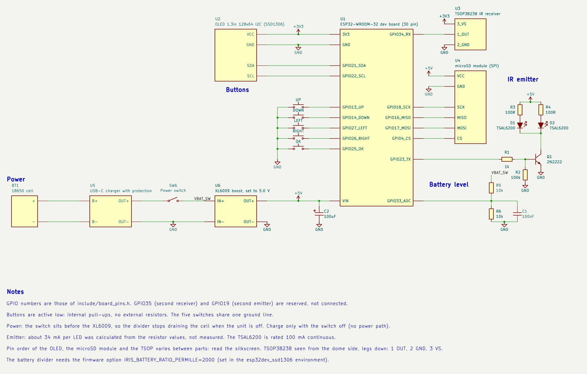

# Wiring

The circuit of the author's unit: what connects to what. GPIO numbers come from
[`include/board_pins.h`](../../include/board_pins.h), the only place in the code with pin numbers.



The same diagram as a KiCad 10 file: [`../schematic/IRis.kicad_sch`](../schematic/IRis.kicad_sch)
([PDF](../schematic/IRis.pdf)).

Related documents: [parts list](bom.md), [component board](component-board.md) (where the loose parts are soldered),
[bring-up](bring-up.md) (how to test each block before adding the next), [design notes](design-notes.md) (why the
circuit is this way and how to size it for other parts), [measurements](measurements.md).

## Safety rules

1. **Never connect an IR LED, or any load, directly to a GPIO.** The LEDs are always driven through the transistor.
2. **Run the first tests from USB only.** Add the battery, the charger and the boost converter last, one at a time.
3. **A lithium cell stores a lot of energy.** Use a protected cell or a charger module with protection, check the
   polarity before connecting, never short the terminals, never use a cell that is swollen, dented or hot, and stay
   next to the first charges, on a surface that does not burn.
4. **The ESP32 pins are 3.3 V only.** Never put 5 V on the 3V3 pin or on a GPIO.
5. **Do not use the battery and the USB of the ESP32 at the same time.** Switch the unit off before plugging the
   ESP32 into a computer.
6. **Charge with the unit switched off.** The charger module has no power path.
7. Switch the power off before changing a wire, and check the polarity with a multimeter before powering a new block.

## Pin map

| ESP32 pin | Goes to |
|---|---|
| VIN | XL6009 `OUT+` (5.0 V) |
| GND | XL6009 `OUT-` and the common ground |
| 3V3 | OLED `VCC`, TSOP38238 `VS` |
| GPIO21 / GPIO22 | OLED `SDA` / `SCL` |
| GPIO13 / 14 / 27 / 26 / 25 | Buttons Up / Down / Left / Right / OK |
| GPIO34 | TSOP38238 `OUT` |
| GPIO23 | Emitter driver: 1 kΩ to the transistor base |
| GPIO18 / 16 / 17 / 4 | microSD `SCK` / `MISO` / `MOSI` / `CS` |
| GPIO33 | Battery divider midpoint |
| GPIO35 | Not connected. Reserved for a second receiver |
| GPIO19 | Not connected. Reserved for a second emitter channel |

Pins avoided on purpose: GPIO 6 to 11 (wired to the flash of the module), 0 / 2 / 5 / 12 / 15 (read at boot; GPIO12
held high at reset can stop the boot) and 1 / 3 (USB serial). GPIO 34 to 39 are inputs only, without pull-ups.

30-pin ESP32 boards differ: compare the labels of your board with this table before wiring.

## Display

OLED 1.3" 128x64, I2C.

- `VCC` to 3V3, `GND` to GND, `SDA` to GPIO21, `SCL` to GPIO22.
- The pin order differs between modules (GND-VCC-SCL-SDA or VCC-GND-SCL-SDA): read the labels of yours.
- No I2C pull-up resistors were added: the module worked without them.
- The controller is an SSD1306 on the author's unit. To find out which one yours has, see
  [Identify the OLED controller](bring-up.md#identify-the-oled-controller).

## Buttons

Five 6 x 6 mm tactile switches on their own small board.

- One pin of each switch to its GPIO: Up 13, Down 14, Left 27, Right 26, OK 25.
- The other pin of each switch to GND. The five share **one** ground line on the button board, with one wire to the
  common ground.
- No resistors: the firmware uses the internal pull-ups and reads a pressed key as low.
- A 6 x 6 switch has two pairs of legs joined inside. Use one leg of each pair; check with the continuity mode of
  the multimeter if unsure.

## IR receiver

TSOP38238. Seen with the dome toward you and the legs down, left to right: 1, 2, 3.

- Pin 1 `OUT` to GPIO34.
- Pin 2 `GND` to GND.
- Pin 3 `VS` to 3V3.
- The output has its own pull-up inside the part. No filter was fitted on its supply.
- In the case it sits behind its own window, with a wall between it and the LEDs so that they do not blind it.

## microSD module

6-pin SPI module with a level shifter and a regulator on board.

- `VCC` to VIN (5 V), `GND` to GND.
- `SCK` to GPIO18, `MISO` to GPIO16, `MOSI` to GPIO17, `CS` to GPIO4.
- The card is formatted as FAT32.

## IR emitter

An NPN transistor (2N2222, TO-92) switches two TSAL6200 LEDs from the 5 V rail.

```
VIN (5 V) --[100 Ω]-- LED 1 anode ... LED 1 cathode --+
VIN (5 V) --[100 Ω]-- LED 2 anode ... LED 2 cathode --+-- collector
GPIO23 --[1 kΩ]-- base --+                             emitter -- GND
                     [100 kΩ] base to GND
```

- 2N2222 pins, seen from the flat face, left to right: **E, B, C**.
- Each LED has its **own** 100 Ω resistor. Never share one resistor between LEDs in parallel.
- The 100 kΩ resistor keeps the transistor off while the ESP32 boots and GPIO23 floats. Fit it before the LEDs are
  ever powered.
- Current: about 34 mA per LED and 68 mA in total. This was **calculated** from the resistor values (forward voltage
  about 1.4 V and transistor drop about 0.2 V assumed), not measured. The TSAL6200 is rated for 100 mA continuous.
- A third LED fits on the component board with its own 100 Ω resistor. Measure the LED current before adding LEDs
  or lowering the resistors.

## Battery level

Optional. Without it the screen shows `Bat n/a` and everything else works.

- XL6009 `IN+` (the battery side, after the power switch) to 10 kΩ, to the midpoint, to 10 kΩ, to GND.
- Midpoint to GPIO33, with 100 nF from the midpoint to GND.
- The firmware needs `-DIRIS_BATTERY_RATIO_PERMILLE=2000`, which the `esp32dev_ssd1306` environment sets in
  [`platformio.ini`](../../platformio.ini). The number is the divider ratio times 1000.
- Because the divider is after the switch, it does not drain the cell while the unit is off.

## Power

```
18650 --- B+ / B-  charger  OUT+ --[power switch]-- IN+  XL6009  OUT+ (5.0 V) --- VIN
                            OUT- ------------------ IN-          OUT- ---------- GND
```

- The cell connects to `B+` / `B-` of the charger module, and the load to `OUT+` / `OUT-`, the protected output.
- The power switch is between the charger `OUT+` and the XL6009 `IN+`. It carries the battery current.
- Set the XL6009 to 5.00 V with its trimmer **before** connecting the ESP32.
- A 100 µF capacitor sits across the 5 V rail on the component board.
- The USB-C of the charger is for charging only, with the switch off. The micro-USB of the ESP32 is for programming
  only, with the switch off.

On the bench the switch was first placed after the XL6009, between its `OUT+` and VIN. That left the converter and
the divider connected to the cell with the unit off (the divider alone draws about 190 µA), so it was moved.

## Ground

All grounds meet on the ground rail of the component board: the XL6009 `OUT-`, the ESP32 GND, the transistor
emitter, the capacitors, the OLED, the receiver, the microSD module and the button board.

## Not connected

- A second TSOP38238 on GPIO35. The firmware has the code path (`IRIS_ENABLE_RX2`) but it was never wired.
- A second emitter channel on GPIO19. The firmware accepts one channel only.
